# Awesome Cloud Infrastructure Management & Optimization ☁️⚡

  

  
  
  
  
  
  

---

## 🌟 Overview & Highlights

A curated directory of leading **SaaS platforms**, **autonomous rightsizers**, and **open-source FinOps tools** focused on Kubernetes cost visibility, workload optimization, multi-cloud financial operations, and infrastructure rightsizing.

Whether managing multi-cloud enterprise budgets across AWS, Azure, and GCP, configuring autonomous container bin-packing and Spot instances, or establishing open showback/chargeback with FOCUS standards, this guide catalogs vetted commercial platforms and active open-source projects.

---

## 📑 Table of Contents

- [📈 Sector Overview & Market Dynamics](#-sector-overview--market-dynamics)
- [🏢 SaaS & Hosted Platforms](#-saas--hosted-platforms)
- [💻 Open-Source GitHub Projects](#-open-source-github-projects)
- [🛠️ FinOps Architecture & Stacks](#-finops-architecture--stacks)
- [🤝 How to Contribute](#-how-to-contribute)
- [💖 Support & Sponsorship](#-support--sponsorship)
- [📈 Star History](#-star-history)
- [⚠️ Disclaimer](#️-disclaimer)

---

## 📈 Sector Overview & Market Dynamics

The global Cloud Cost Management and FinOps market is estimated between **$13 billion and $15.2 billion**, compounding at a double-digit CAGR of **11%–14%** fueled by multi-cloud complexity and surging AI/GPU infrastructure expenditures. 

The sector is **moderately fragmented**: the top tier is concentrated among hyperscalers (AWS Cost Explorer, Azure Cost Management, GCP Billing) and legacy enterprise titans (IBM/Apptio, Flexera) capturing roughly **45%–50%** of total revenue. Meanwhile, the remaining market comprises an innovative and fast-growing long tail of specialized autonomous optimization vendors, Kubernetes-native rightsizers, and FinOps platforms enabled by vendor-neutral standards such as the FinOps Foundation's FOCUS (FinOps Open Cost and Usage Specification).

---

## 🏢 SaaS & Hosted Platforms

| Platform | Company Size (Revenue / Valuation) | Pricing (Starting Tier) | Free Tier Limits / Free Trial | Key Capabilities & Highlights |
| :--- | :--- | :--- | :--- | :--- |
| **[Apptio Cloudability](https://www.apptio.com/products/cloudability/)** (IBM) | **Parent Market Cap: ~$240B+** (Acquired Apptio for $4.6B; ~$67.5B FY25 revenue) | Starts at ~$30,000/year (billed annually based on % of monitored cloud spend via enterprise contracts/AWS Marketplace) | Free Trial available upon sales qualification / POC agreement (typically 14–30 days) | Enterprise FinOps governance, unit cost modeling, and autonomous RI/Savings Plan conversion automating 1,400+ monthly actions. |
| **[Snowflake Cloud Services Layer](https://www.snowflake.com/)** | **Market Cap: ~$110B–$115B** (~$4.68B FY26 revenue) | Starts at $2.00/credit (Standard Edition on-demand; $3.00/credit for Enterprise) + compute warehouse usage | 30-day free trial with $400 in free trial credits (expires at 30 days or when credits deplete) | Metadata, security, and query optimization layer within Snowflake; cost guidance for high-frequency queries and auto-suspend management. |
| **[Spot by NetApp](https://spot.io/)** | **Parent Market Cap: ~$42B+** (~$6.93B FY26 revenue; Spot acquired for $450M) | Pay-as-you-go starting at percentage of compute savings or ~$0.08–$0.10/instance-hour on marketplaces | 14-day free trial (full features on AWS Marketplace); free tier covers up to 20 virtual machines | Continuous automated optimization and balancing of Spot, Reserved, and On-Demand instances (Ocean & Elastigroup) returning up to 20% DevOps time. |
| **[CAST AI](https://cast.ai/)** | **Valuation: ~$1.0B+** (Series C Unicorn; $180M+ total funding raised) | Paid automation plans scale per managed vCPU/month (~$0.015–$0.025/vCPU-hr) or percentage of savings | Free forever Kubernetes cost monitoring (unlimited clusters/namespaces, read-only); 30-day free trial for automated rightsizing/autoscaling | Autonomous all-in-one Kubernetes optimization: real-time autoscaling, pod rightsizing, automated bin-packing, and Spot automation. |
| **[CloudZero](https://www.cloudzero.com/)** | **Valuation: ~$250M–$500M** (Series C; $118M total funding raised) | Starts at $19.00/month per $1,000 of monitored cloud spend on AWS Marketplace (approx. 1.9% of cloud spend; annual commitments typical) | Free trial / POC pilot available via AWS Marketplace upon sales request (typically 14–30 days) | Real-time cloud cost intelligence with automated anomaly detection, unit economics (cost per customer/feature), and dedicated FinOps account managers. |
| **[Vantage](https://www.vantage.sh/)** | **Valuation: ~$150M–$250M** (Series B; $53M total funding raised) | **Pro Plan**: $30/month (covers up to $7,500/mo tracked cloud spend, 5 users) | **Starter (Free forever)**: $0/month for up to $2,500/mo tracked cloud spend (3 users, 6-month retention) | Multi-cloud cost visibility, FinOps as Code (Terraform provider), Cloud Cost Handbook, and virtual tagging across providers. |
| **[Zesty](https://zesty.co/)** | **Valuation: ~$120M–$150M** ($117M total funding raised; ~$8M–$10M ARR) | Platform plans start at $5,000/month on AWS Marketplace, or 25% commission fee on realized cloud cost savings | Historical CUR audit & ROI proof analysis (no standalone self-serve free trial; risk-free ROI projection model) | Automated real-time disk scaling (Z-Storage) and dynamic compute reservation balancing (Commitment Manager) with 5-minute onboarding. |
| **[Anodot](https://www.anodot.com/)** | **Valuation: ~$60M–$80M** ($65M+ total funding raised; peak ARR ~$10M–$14M) | Mid-market and enterprise packages starting at ~$40,000/year via cloud marketplace contracts | 30 to 60-day scoped Proof-of-Concept (POC) / pilot trial through sales qualification | AI-driven multi-cloud and SaaS cost monitoring, CostGPT assistant, automated anomaly alerting, and forecasting dashboards. |
| **[Kubecost](https://kubecost.com/)** | **Acquired by IBM/Apptio** ($30.5M venture funding raised prior to acquisition) | **Business Tier**: Starts at $449/month (up to ~200 nodes, 30+ day retention, multi-cluster federation) | **Foundations (Free forever)**: Supports up to 250 CPU cores across unlimited clusters with 15-day data retention | Kubernetes cost allocation built on OpenCost with real-time rightsizing recommendations, health alerts, and cloud billing discount reconciliation. |

---

## 💻 Open-Source GitHub Projects

Sorted in descending order by GitHub_Stars ⭐. Each repository includes official links, social Stars_Counts, architectural scope, and practical tradeoffs.

### 1. **[Infracost](https://github.com/infracost/infracost)** 
- **Description**: Cloud cost estimates for Terraform in pull requests and CI/CD pipelines (Apache 2.0). Surfaces cost deltas for AWS, Azure, and Google Cloud infrastructure before code is merged.
- **Key Features**: Pull request comments showing monthly cost impacts, breakdown per resource, threshold guardrails, and CLI integration.
- **Trade-off**: Shift-left cost estimation prior to provisioning—does not monitor ongoing cloud waste, rightsizing, or live telemetry post-deployment.
- **Best For**: Engineering teams wanting shift-left cost governance directly in GitHub/GitLab pull requests.

### 2. **[OpenCost](https://github.com/opencost/opencost)** 
- **Description**: Vendor-neutral Kubernetes cost monitoring and allocation specification (Apache 2.0), hosted under the Cloud Native Computing Foundation (CNCF).
- **Key Features**: Real-time cost allocation by cluster, namespace, controller, service, and custom labels (`team=payments`). Integrates with AWS CUR, Azure Rate Card, and GCP Billing APIs. Includes an opt-in MCP server for AI agent workflows.
- **Trade-off**: Provides visibility only—no native automated rightsizing, active remediation, or discount reconciliation (creating a 30%–50% variance from effective enterprise rates).
- **Best For**: Platform teams requiring a standardized, vendor-neutral Kubernetes cost visibility engine.

### 3. **[Cloud Custodian](https://github.com/cloud-custodian/cloud-custodian)** 
- **Description**: Lightweight rules engine for multi-cloud management, automated compliance, security, and cost optimization (Apache 2.0).
- **Key Features**: Declarative YAML policies for tagging enforcement, unattached EBS volume deletion, idle resource stopping/off-hours scheduling, and real-time event-driven remediation via AWS Lambda, Azure Functions, and GCP Cloud Functions.
- **Trade-off**: Requires writing and maintaining custom YAML policies; rule execution without careful dry-runs can inadvertently terminate in-use development resources.
- **Best For**: Cloud platform and security engineers automating cloud waste cleanup and governance across AWS, Azure, and GCP.

### 4. **[ec2instances.info (Vantage Instances)](https://github.com/vantage-sh/ec2instances.info)** 
- **Description**: Open-source scraper and database comparing AWS EC2, RDS, and ElastiCache pricing, memory, compute specs, and GPU configurations (Apache 2.0).
- **Key Features**: Comprehensive matrix comparing on-demand, spot, and reserved instance pricing, network performance, and architecture per AWS region.
- **Trade-off**: Static lookup data table without cluster telemetry or infrastructure integration.
- **Best For**: Architects and developers comparing AWS instance families, pricing tiers, and hardware specs during system design.

### 5. **[KRR (Kubernetes Resource Recommender)](https://github.com/robusta-dev/krr)** 
- **Description**: CLI tool by Robusta for Kubernetes resource rightsizing recommendations based on Prometheus metrics (MIT License).
- **Key Features**: Analyzes historical CPU and memory usage to calculate recommended CPU/RAM requests and limits. Requires no cluster agent—runs locally via `kubectl` and queries Prometheus directly.
- **Trade-off**: Recommendation engine only—does not automatically apply YAML mutations to production Deployments or StatefulSets.
- **Best For**: DevOps engineers who want quick, actionable CLI recommendations for Kubernetes container requests and limits without deploying heavy daemonsets.

### 6. **[Goldilocks](https://github.com/FairwindsOps/goldilocks)** 
- **Description**: Kubernetes utility that identifies starting points for resource requests and limits using the Vertical Pod Autoscaler (VPA) in recommendation mode (Apache 2.0).
- **Key Features**: Automatically creates VPAs for workloads in labeled namespaces, provides an intuitive web dashboard, and generates benchmark recommendations.
- **Trade-off**: Relies on the Kubernetes Vertical Pod Autoscaler; lacks built-in financial pricing translation (displays CPU/RAM rather than dollar impacts).
- **Best For**: Teams calibrating Kubernetes resource requests to eliminate OOM kills and overprovisioning.

### 7. **[Karpenter](https://github.com/kubernetes-sigs/karpenter)** 
- **Description**: Flexible, high-performance Kubernetes node autoscaler designed to optimize cluster compute capacity and minimize cloud spending (Apache 2.0).
- **Key Features**: Observes unschedulable pods, bypasses node groups, and launches precisely right-sized compute instances within seconds; automatically consolidates and drains underutilized nodes to save compute costs.
- **Trade-off**: Dynamic node provisioning requires careful disruption budgeting (PDBs) and spot termination handling to avoid application interruptions.
- **Best For**: Workloads on EKS and Kubernetes needing dynamic, rapid compute scaling and automated spot/on-demand node consolidation.

### 8. **[Kubecost Helm Chart](https://github.com/kubecost/cost-analyzer-helm-chart)** 
- **Description**: Deployment package and open-source core analyzer for Kubecost, tracking real-time Kubernetes spend (Apache 2.0 core).
- **Key Features**: Multi-cloud Kubernetes cost tracking, out-of-the-box Grafana dashboards, health checks, and waste recommendations.
- **Trade-off**: Free tier caps data retention at 15–30 days and enforces spend limits (unless using the AWS EKS customized bundle).
- **Best For**: Quick deployment of Kubernetes cost monitoring with ready-made dashboards on EKS, GKE, or AKS.

### 9. **[Koku](https://github.com/project-koku/koku)** 
- **Description**: Open-source cost management engine for hybrid cloud environments, OpenShift, and Kubernetes (AGPL-3.0).
- **Key Features**: Ingests, processes, and normalizes cloud usage data across AWS, Azure, GCP, and Red Hat OpenShift, calculating tag-based chargeback and showback.
- **Trade-off**: Requires dedicated infrastructure (PostgreSQL, Kafka, Trino) to manage data pipelines; tailored primarily for OpenShift/hybrid enterprise deployments.
- **Best For**: Hybrid enterprise organizations running Red Hat OpenShift alongside public cloud providers.

### 10. **[FOCUS Converters](https://github.com/finopsfoundation/focus_converters)** 
- **Description**: Specification converters and normalization scripts from the FinOps Foundation for the FOCUS open standard (Apache 2.0).
- **Key Features**: Converts raw AWS CUR, Azure EA/MCA, and GCP BigQuery billing exports into a unified, normalized FOCUS schema.
- **Trade-off**: Data pipeline utility only—no graphical interface, alerting, or direct rightsizing actions.
- **Best For**: FinOps data practitioners building unified multi-cloud data warehouses and analytics.

### 11. **[OpenCost UI](https://github.com/opencost/opencost-ui)** 
- **Description**: Clean web visualization interface for OpenCost data (Apache 2.0).
- **Key Features**: Visualizes cost allocation across namespaces, nodes, controllers, and services; displays real-time asset spending breakdowns.
- **Trade-off**: Visual layer only—requires a running OpenCost core service.
- **Best For**: Teams needing a standalone, lightweight UI for OpenCost without commercial licenses.

### 12. **[k8s-rightsizer](https://github.com/mcpunzo/k8s-rightsizer)** 
- **Description**: Automated Kubernetes rightsizing tool featuring safety rollback protection (MIT License).
- **Key Features**: Automatically applies rightsizing recommendations and triggers automatic rollbacks if pods encounter failures (OOMKilled, CrashLoopBackOff, Unschedulable).
- **Trade-off**: Ingests recommendations from external files rather than directly querying live Prometheus metrics dynamically.
- **Best For**: Platform engineers wanting automated execution of rightsizing proposals with safety rollbacks.

---

## 🛠️ FinOps Architecture & Stacks

### Recommended Open-Source Stacks
- **End-to-End Kubernetes Cost Management**: Pair **OpenCost** (for cost allocation) + **KRR** or **Goldilocks** (for resource sizing) + **Karpenter** (for autoscaling & node consolidation).
- **Multi-Cloud Data Warehousing**: Ingest billing exports through **FOCUS Converters** into ClickHouse or DuckDB for unified FinOps reporting.
- **Shift-Left CI/CD Governance**: Integrate **Infracost** in GitHub Actions with **Cloud Custodian** for automated account cleanup and guardrails.

---

## 🤝 How to Contribute

Contributions are warmly welcomed! Help make this curated FinOps directory comprehensive and accurate:

1. 🍴 Fork the repository.
2. 🌿 Create a new feature branch (`git checkout -b feature/new-tool`).
3. 📝 Add your entry to [README.md](README.md) adhering to the existing tabular/markdown formats (ensure valid license and exact pricing/stars data).
4. 🚀 Commit your changes (`git commit -m "Add new open-source FinOps tool"`) and push (`git push origin feature/new-tool`).
5. 📬 Open a Pull Request with a clear description of the project.

---

## 💖 Support & Sponsorship

If you find this repository valuable for your cloud infrastructure optimization, Kubernetes rightsizing, or FinOps initiatives, please consider supporting the project:

- 🌟 **Star this repository** to help others discover it on GitHub.
- 🍴 **Fork and share** it with fellow DevOps, FinOps, and SRE team members.
- ☕ **Sponsor the Maintainer**: Support ongoing curation and open-source contributions via the **[GitHub Sponsor Dashboard](https://github.com/sponsors/ishandutta2007)**.

Thank you for your generous support and engagement with the open-source community! ❤️

---

## 📈 Star History

---

## ⚠️ Disclaimer

- This repository is a **community-curated guide** intended for informational and educational purposes—it does not constitute an explicit endorsement of any commercial platform or open-source tool.
- Platforms handling cloud billing credentials and cluster infrastructure must comply with organizational security policies, least-privilege RBAC, and data privacy frameworks (e.g., SOC2, GDPR, CCPA).
- **Visibility vs. Optimization vs. Automation**: Tools like OpenCost provide visibility; recommendation engines like KRR and Goldilocks provide optimization advice; and autonomous tools like Karpenter, CAST AI, and Spot actively mutate infrastructure. Always test automated tools in staging environments with PodDisruptionBudgets enabled before deploying to production.
- Pricing metrics, marketplace rates, and Stars_Counts are subject to change. Always verify current offerings with respective vendor documentation and repositories.

---

  <b>Built with ❤️ for FinOps engineers, platform architects, and DevOps teams worldwide.</b>

